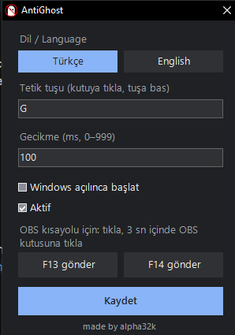

# AntiGhost

[Türkçe](#türkçe) · [English](#english)

<p align="center">
  
</p>

---

## Türkçe

AntiGhost, Rust yayıncıları için küçük bir **yayın izleyicisi (stream sniping) karşıtı** araçtır. Haritayı açtığınız tuşa (varsayılan `G`) bastığınız anda OBS'e bir kısayol gönderir; OBS de yayında haritanın üstüne bir kapak resmi koyar. Böylece "ghost"çular haritadan hangi sunucuda olduğunuzu bulamaz.

Oyuna dokunmaz: `G` tuşu engellenmez, oyuna normal ulaşır. Program yalnızca klavyeyi dinler ve `F13` / `F14` tuşlarını gönderir. OBS'e doğrudan bağlanmadığı için ek bir eklenti veya WebSocket ayarı gerekmez.

### Kurulum

1. [Releases](https://github.com/alpha32k/AntiGhost/releases/latest) sayfasından `AntiGhost.exe` dosyasını indirin.
2. İstediğiniz bir klasöre koyup çalıştırın. Kurulum, yönetici izni veya ek bir program gerekmez (Windows 10/11, x64).
3. Saatin yanında (bildirim alanında) simgesi görünür.

Dosya imzalı değilse Windows SmartScreen "tanınmayan yayımcı" uyarısı gösterebilir.

### Özellikler

- `G` tuşuna basınca `F13`, bırakınca (varsayılan 100 ms sonra) `F14` gönderir.
- Tetik tuşunu engellemez; oyun tuşu normal alır.
- Tuşa tekrar basılırsa bekleyen `F14` iptal edilir.
- Tetik tuşu, gecikme ve Windows'la başlama ayarlanabilir.
- Türkçe ve English; ayarlardan anında değiştirilir, ilk açılışta Windows'un diline uyar.
- OBS kısayollarını atamak için `F13` / `F14` gönder düğmeleri (klavyenizde bu tuşlar yoksa).
- Koyu tema, bildirim alanında çalışır, işlemciyi neredeyse hiç kullanmaz, tek dosya (~30 KB).

### OBS kurulumu

1. AntiGhost'u açın. Tepsideki simgeye çift tıklayarak **Ayarlar**'ı açın.
2. OBS'te haritanın kapak resmini bir kaynak olarak ekleyin ve oyun yakalamayı (Game Capture) aynı sahneye koyun.
3. OBS > **Ayarlar > Kısayol Tuşları**'nı açın.
4. Kapak resmi kaynağı için "Göster" satırındaki kutuya tıklayın. Hemen ardından AntiGhost'ta **F13 gönder**'e basın ve 3 saniye dolmadan OBS'teki kutuya tıklayın. Süre bitince kutuya `F13` yazılır.
5. Aynı kaynağın "Gizle" satırı için aynısını **F14 gönder** ile yapın.
6. Oyun yakalama kaynağı için bunun tersini atayın: `F13` = gizle, `F14` = göster.
7. Uygula'ya basın. Artık `G`'ye bastığınızda yayında harita gizlenir, bıraktığınızda geri gelir.

Düğmelerdeki 3 saniye, tuşun OBS'in kutusuna ulaşması için ayrılan zamandır; çünkü tepsiye veya pencereye tıklamak odağı OBS'ten alır.

### Ayarlar

Ayarlar penceresi ve `AntiGhost.ini` dosyası aynı değerleri tutar.

| Ayar | Anlamı | Varsayılan |
|---|---|---|
| Dil | Türkçe veya English | Windows'un dili |
| Tetik tuşu | Bu tuşa basılınca `F13`, bırakılınca `F14` gider | `G` |
| Gecikme | Tuş bırakıldıktan sonra `F14`'ün gönderilmesi (0–999 ms) | `100` |
| Windows açılınca başlat | Bilgisayar açılınca kendiliğinden çalışır | kapalı |
| Aktif | Kapatınca tuşlar gönderilmez | açık |

`AntiGhost.ini` (exe'nin yanında) `trigger`, `down_key`, `up_key`, `delay_ms` ve `language` (`tr` / `en`) satırlarını içerir. Tuş olarak `A-Z`, `0-9`, `F1-F24` veya `0xHEX` (sanal tuş kodu) yazılabilir.

### Kaynaktan derleme

Ek bir şey kurmanız gerekmez; Windows'la gelen .NET Framework derleyicisi yeter:

```text
C:\Windows\Microsoft.NET\Framework64\v4.0.30319\csc.exe /target:winexe /optimize+ /win32icon:AntiGhost.ico /out:AntiGhost.exe /r:System.Windows.Forms.dll /r:System.Drawing.dll AntiGhost.cs
```

### Lisans

[MIT](LICENSE). [Ahmet Şahin](https://github.com/alpha32k) tarafından yapıldı.

---

## English

AntiGhost is a small **anti stream-sniping** tool for Rust streamers. The moment you press your map key (default `G`) it sends a hotkey to OBS, and OBS puts a cover image over the map on stream. Ghosters watching you can no longer read the map to find out which server you are on.

It never touches the game: the `G` key is not blocked and reaches the game as usual. The program only listens to the keyboard and sends `F13` / `F14`. It does not connect to OBS directly, so no plugin or WebSocket setup is needed.

### Installation

1. Download `AntiGhost.exe` from the [Releases](https://github.com/alpha32k/AntiGhost/releases/latest) page.
2. Put it in any folder and run it. No installer, administrator rights or extra software needed (Windows 10/11, x64).
3. Its icon appears in the notification area next to the clock.

When the file is not signed, Windows SmartScreen may warn about an "unknown publisher".

### Features

- Sends `F13` when you press `G` and `F14` when you release it (after 100 ms by default).
- Does not block the trigger key; the game receives it normally.
- If the key is pressed again, the pending `F14` is cancelled.
- Trigger key, delay and start with Windows can be changed.
- Turkish and English; switch instantly in the settings, follows the Windows language on first start.
- "Send F13" / "Send F14" buttons for assigning the OBS hotkeys (when your keyboard has no such keys).
- Dark theme, lives in the notification area, uses almost no CPU, a single file (~30 KB).

### OBS setup

1. Start AntiGhost. Double-click its tray icon to open **Settings**.
2. In OBS, add the map cover image as a source and put your Game Capture in the same scene.
3. Open OBS > **Settings > Hotkeys**.
4. For the cover image source, click the box in its "Show" row. Right after that, press **Send F13** in AntiGhost and click the box in OBS before the 3 seconds run out. When the time is up, `F13` is typed into the box.
5. Do the same for the same source's "Hide" row with **Send F14**.
6. For the Game Capture source assign the opposite: `F13` = hide, `F14` = show.
7. Press Apply. Now the map is hidden on stream while you hold `G` and comes back when you release it.

The 3 seconds on the buttons give you time to click into OBS's box, because clicking the tray or the window takes focus away from OBS.

### Settings

The settings window and the `AntiGhost.ini` file hold the same values.

| Setting | Meaning | Default |
|---|---|---|
| Language | Türkçe or English | Windows language |
| Trigger key | `F13` is sent when it is pressed, `F14` when it is released | `G` |
| Delay | Time after the release before `F14` is sent (0–999 ms) | `100` |
| Start with Windows | Runs automatically when the PC starts | off |
| Active | When off, no keys are sent | on |

`AntiGhost.ini` (next to the exe) contains the lines `trigger`, `down_key`, `up_key`, `delay_ms` and `language` (`tr` / `en`). Keys can be written as `A-Z`, `0-9`, `F1-F24` or `0xHEX` (virtual-key code).

### Building from source

Nothing to install; the .NET Framework compiler that ships with Windows is enough:

```text
C:\Windows\Microsoft.NET\Framework64\v4.0.30319\csc.exe /target:winexe /optimize+ /win32icon:AntiGhost.ico /out:AntiGhost.exe /r:System.Windows.Forms.dll /r:System.Drawing.dll AntiGhost.cs
```

### License

[MIT](LICENSE). Made by [Ahmet Şahin](https://github.com/alpha32k).
